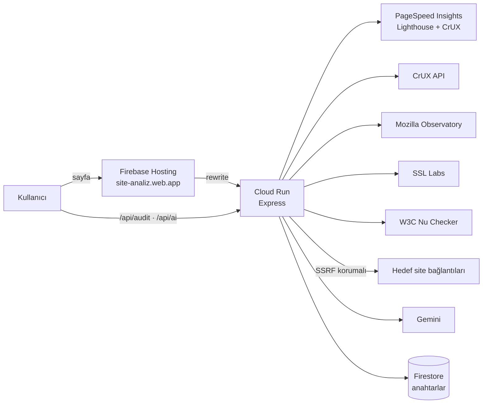

<div align="center">

# 🔎 SiteAnaliz

**Web sitenin sorunlarını bul, her biri için Claude veya ChatGPT'ye yapıştırılacak hazır düzeltme prompt'unu al.**

Lighthouse · Gerçek kullanıcı verisi (CrUX) · Güvenlik başlıkları · SSL/TLS · HTML doğrulama · Kırık bağlantılar

[](https://site-analiz.web.app/)
[](https://yucelgumus.dev/)


[Canlı demo](https://site-analiz.web.app/) · [Özellikler](#-özellikler) · [Analiz modları](#-analiz-modları) · [Kurulum](#-kurulum) · [Mimari](#-mimari) · [Güvenlik](#-güvenlik)

</div>

---

## ✨ Özellikler

| | |
|---|---|
| 🧭 **İki mod** | **Tam analiz** (Lighthouse'un 4 kategorisi + CrUX) veya **Özel mod** (9 analizden yalnızca biri) |
| 📋 **Hazır prompt'lar** | Her sorun, her kategori ve tüm site için; cihaz, teknoloji, ölçüm, etkilenen öğe ve doğrulama adımlarıyla birlikte |
| 🎯 **Kategoriye özel** | Erişilebilirlikte WCAG kriteri, güvenlikte saldırı senaryosu ve `Report-Only` geçişi, performansta metrik kazancı istenir |
| 🧠 **Gemini analizi** | Türkçe özet, etki/çaba sıralı öncelik planı, sorun açıklamaları ve tüm site için tek ana prompt |
| 🔍 **Teknoloji algılama** | Next.js, Nuxt, WordPress, Shopify, Astro ve Tailwind izleri; prompt'lar algılanan teknolojiye göre şekillenir |
| 🎮 **Bekleme oyunu** | Analiz sürerken oynanan, fizik tabanlı "Havan Topu"; ilerleme tarayıcıda saklanır |

## 🧪 Analiz modları

### Tam analiz
Tek PageSpeed Insights çağrısıyla **Performance, Accessibility, Best Practices, SEO** ve **gerçek kullanıcı verisi (CrUX)** gelir. CrUX aynı yanıttan okunduğu için ek süre gerektirmez.

### Özel mod
Listeden **tek bir** analiz seçilir:

| Analiz | Kaynak | Süre | Not |
|---|---|---|---|
| ⚡ Performance · ♿ Accessibility · ✅ Best Practices · 🔎 SEO | Google Lighthouse | 20–60 sn | Tek kategori |
| 👥 Gerçek Kullanıcı (CrUX) | Chrome UX Report API | < 1 sn | Son 28 gün; az trafikli sitelerde veri yoktur |
| 🛡️ Güvenlik Başlıkları | Mozilla HTTP Observatory | birkaç sn | CSP, HSTS, X-Frame-Options, Referrer-Policy… |
| 🔒 SSL/TLS | Qualys SSL Labs | önbellekte anında, yeni 1–4 dk | Her sunucu IP'si ayrı; herkese açık panoda yayınlanmaz |
| 🧱 HTML Doğrulama | W3C Nu HTML Checker | birkaç sn | Tekrarlanan mesajlar gruplanır |
| 🔗 Kırık Bağlantılar | SiteAnaliz tarayıcısı | 10–60 sn | İlk 60 bağlantı, sunucudan gelen HTML |

> [!NOTE]
> Mobil/Masaüstü seçimi yalnızca Lighthouse ve CrUX analizlerini etkiler; diğerlerinde kilitlenir. W3C ve kırık bağlantı skorları ilgili servisin değil, SiteAnaliz'in hesapladığı göstergelerdir ve arayüzde böyle belirtilir.

## 🚀 Kurulum

```bash
git clone git@github.com:yucel-gumus/web-site-analiz.git
cd web-site-analiz
npm install
npm start      # http://localhost:3000
npm test       # node:test, harici test kütüphanesi yok
```

<details>
<summary><b>⚙️ Yapılandırma</b></summary>

Anahtarlar Firestore'da `aimunazara` projesi, `system_config/llm` belgesinde tutulur ve 5 dakika önbelleğe alınır.

| Alan / değişken | Açıklama |
|---|---|
| `pagespeed_api_key` / `PSI_API_KEY` | PageSpeed Insights (ve CrUX API) anahtarı |
| `gemini_api_key_primary` / `GEMINI_API_KEY` | Gemini anahtarı |
| `active_model` / `GEMINI_MODEL` | Model (varsayılan `gemini-3.8-flash`) |
| `FIREBASE_PROJECT_ID` | Yapılandırma belgesinin projesi (varsayılan `aimunazara`) |
| `TRUST_PROXY` | `X-Forwarded-For` güveni; Cloud Run'da (`K_SERVICE`) otomatik |
| `CORS_ORIGINS` | API'yi çağırabilecek kökenler (varsayılan `site-analiz.web.app`, `site-analiz.firebaseapp.com`) |

Ortam değişkenleri Firestore'dan önceliklidir (örnek: `.env.example`). Yerelde Firestore için `gcloud auth application-default login` gerekir. CrUX API'nin hızlı yolu için anahtarın projesinde **Chrome UX Report API** açık ve anahtarın API kısıtlamasına ekli olmalıdır; değilse veri PageSpeed üzerinden alınır.

</details>

<details>
<summary><b>☁️ Dağıtım (Cloud Run + Firebase Hosting)</b></summary>

```bash
# 1) Uygulama: Cloud Run
gcloud run deploy site-analiz --source . --project agenticai-500618 --region europe-west3 \
  --allow-unauthenticated --timeout 300 --max-instances 1

# 2) Alan adı: Firebase Hosting (site-analiz.web.app → Cloud Run)
npx firebase-tools deploy --only hosting
```

- `--timeout 300`: yeni bir SSL Labs taraması 4 dakikaya kadar sürebilir.
- `--max-instances 1`: raporlar ve hız sınırları bellekte; AI isteği raporla aynı örneğe gitmelidir.
- Firebase Hosting, Cloud Run'a yönlendirdiği istekleri **60 sn'de keser**. Bu yüzden sayfa `site-analiz.web.app`'ten sunulur, uzun süren `/api/*` çağrıları ise doğrudan Cloud Run adresine yapılır (yalnızca Firebase kökenlerine açık CORS).

</details>

## 🏗️ Mimari



<details>
<summary><b>📁 Dosya yapısı</b></summary>

```text
server/
  index.js            Express, /api/audit ve /api/ai, hız sınırı, CORS
  analyses.js         Analiz türleri; tam analiz / özel mod yönlendirmesi
  psi.js              PageSpeed Insights istemcisi, Lighthouse normalizasyonu
  checks/
    crux.js           Chrome UX Report (PageSpeed alanı veya CrUX API)
    observatory.js    Mozilla HTTP Observatory
    ssllabs.js        Qualys SSL Labs (yoklamalı)
    w3c.js            W3C Nu HTML Checker
    links.js          Kırık bağlantı taraması
  safe-fetch.js       SSRF korumalı HTTP istemcisi
  url-guard.js        URL ve IP doğrulama
  prompts.js          Kategoriye özel prompt şablonları, uyarı açıklamaları
  ai.js               Gemini analizi
  report-store.js     Raporların kısa süreli bellek önbelleği
  config.js           Firestore / ortam değişkeni yapılandırması
public/               Arayüz (vanilla HTML/CSS/JS) ve bekleme oyunu
test/                 node:test testleri
firebase.json         Firebase Hosting → Cloud Run yönlendirmesi
```

</details>

## 🔐 Güvenlik

- **URL denetimi:** yalnızca herkese açık `http/https`. `localhost` (sondaki noktalı biçimi dahil), `.local`/`.internal`, özel ve ayrılmış IPv4 blokları (CGNAT dahil) ve IPv6 yazımları reddedilir.
- **SSRF koruması:** sunucunun kendisinin istek attığı tek yol kırık bağlantı taramasıdır; her bağlantıda ve yönlendirmede DNS sonucu kontrol edilir, özel ağ IP'lerine bağlanılmaz (DNS rebinding dahil).
- **Kötüye kullanım:** IP başına dakikada 10 analiz ve 6 AI isteği; AI, istemciden gelen metni değil sunucuda 15 dakika saklanan raporu işler ve eşzamanlı istekler tek Gemini çağrısını paylaşır.
- **Prompt injection:** taranan site içeriği modele güvenilmeyen veri olarak verilir, tüm `<` karakterleri kaçışlanır, model çıktısı şemayla doğrulanır.
- **XSS:** arayüzde `innerHTML` yoktur; her şey `textContent` ile basılır.
- **Gizlilik:** beklenmeyen iç hata ayrıntıları kullanıcıya gösterilmez; anahtarlar koddan ayrı, Firestore'da tutulur.

## 🎨 Tasarım kısıtları

Sıfır ön yüz bağımlılığı. Arayüzde yalnızca 9 renklik **bej · kiremit · kahve** paleti kullanılır; saydamlık, gradyan ve gölge yoktur. Kurallar `test/palet.test.js` ile otomatik denetlenir.

---

<div align="center">

### 👋 Geliştiren

**Yücel Gümüş** · Full Stack Developer & Yazılım Mühendisi

[](https://yucelgumus.dev/)
[](https://github.com/yucel-gumus)

</div>
